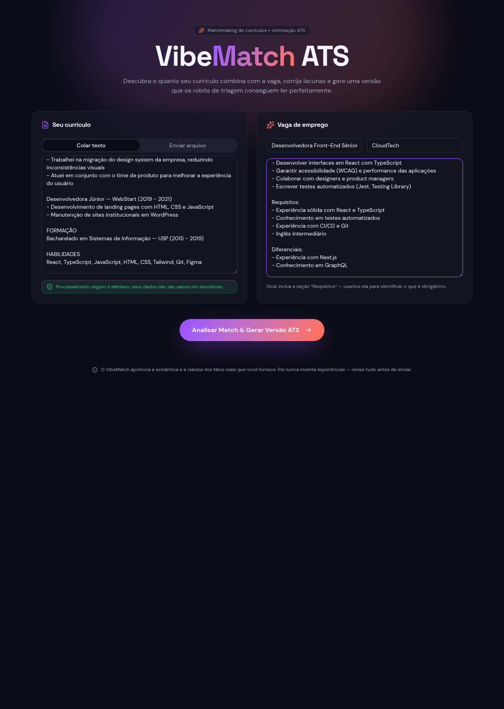
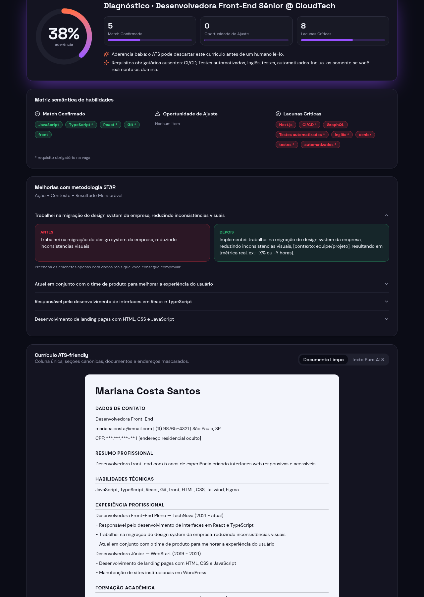
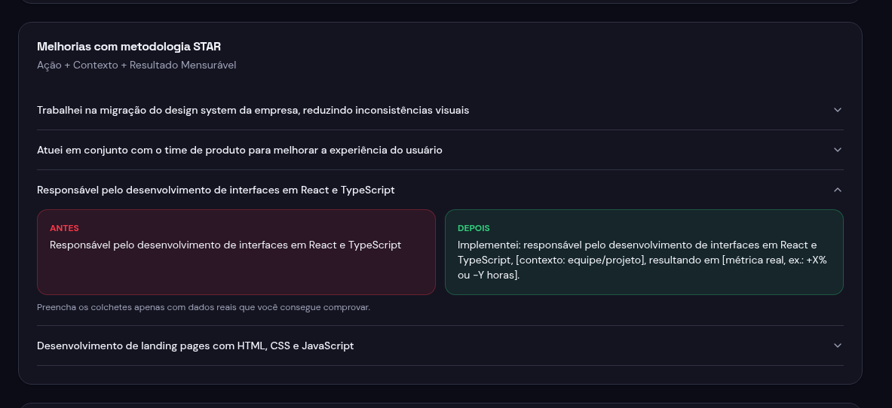
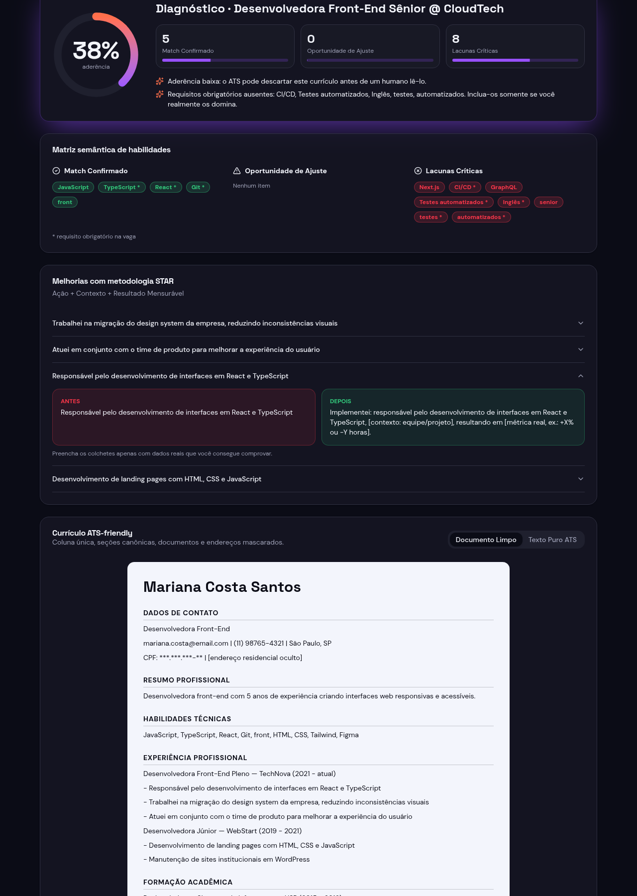
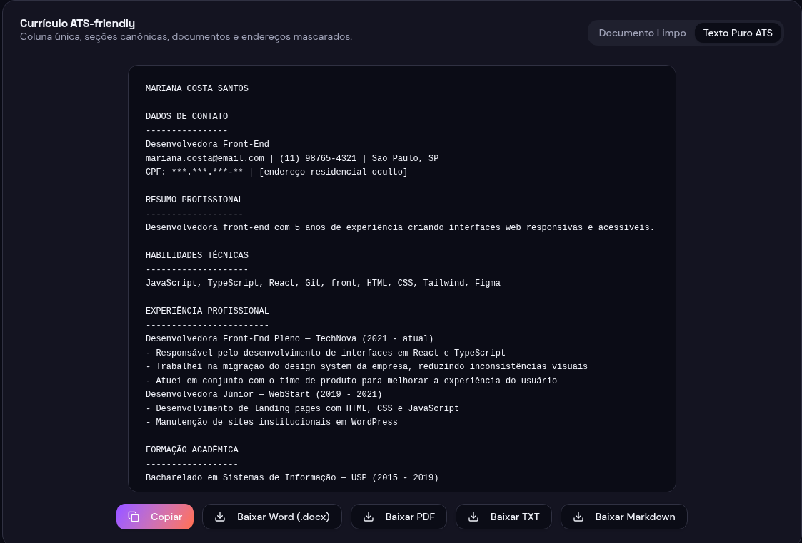
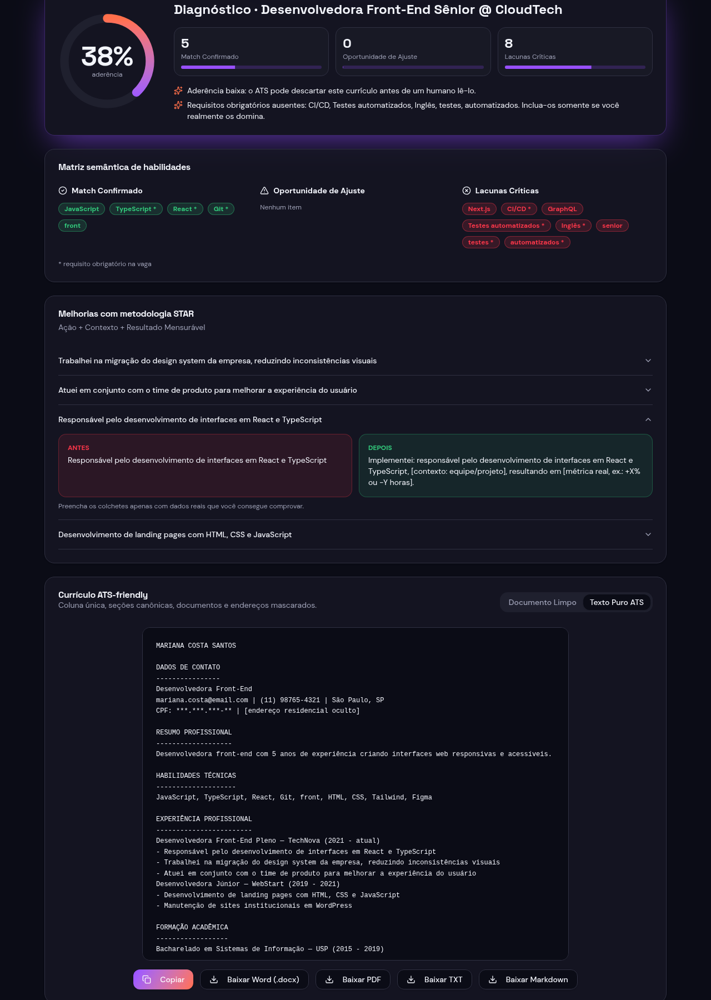

# 🎯 VibeMatch ATS — Matchmaking de Currículos & Otimização para ATS

> VibeMatch ATS compara um currículo com uma vaga, mostra o percentual de match, as palavras-chave encontradas e as que faltam, e gera uma versão do currículo ajustada para ATS, pronta para baixar em PDF ou Word (.docx).


**Aplicação publicada:** https://vibematchats.lovable.app

> **Regra de ética:** a aplicação melhora a forma como a pessoa se apresenta e **nunca inventa experiências**. As sugestões só reescrevem fatos reais. Quando falta um número (por exemplo, um resultado em %), ela deixa um espaço marcado para a própria pessoa preencher.

---

## 🎓 Contexto acadêmico

Projeto do desafio da [DIO](https://www.dio.me): **Criando um Gerador de Currículos ATS Friendly com Lovable**

---

## 📑 Sumário

- [1. Qual problema a aplicação resolve](#1-qual-problema-a-aplicação-resolve)
- [2. O mega prompt e o que mudou](#2-o-mega-prompt-e-o-que-mudou)
  - [Escopo do MVP](#escopo-do-mvp)
- [3. Como a análise funciona](#3-como-a-análise-funciona)
- [4. Ajustes pedidos depois da primeira geração](#4-ajustes-pedidos-depois-da-primeira-geração)
- [5. Exemplo de uso](#5-exemplo-de-uso)
  - [Prints da aplicação](#prints-da-aplicação)
- [6. Tecnologias](#6-tecnologias)
  - [Rodar localmente](#rodar-localmente)

---

## 1. Qual problema a aplicação resolve

Muitas empresas usam um ATS (*Applicant Tracking System*) que ranqueia candidatos antes de qualquer pessoa do RH ler o currículo. Um bom profissional pode ser descartado só porque o currículo não usa os termos da vaga ou tem um formato que o sistema não consegue ler.

O VibeMatch ATS mostra, em segundos:
- o quanto o currículo combina com a vaga;
- quais competências já aparecem, quais aparecem só em parte e quais faltam;
- como reescrever conquistas no formato STAR (Situação, Tarefa, Ação, Resultado);
- uma versão limpa e legível por ATS, para baixar na hora.

**Privacidade:** toda a análise roda no navegador. Nenhum dado do currículo é enviado para servidor, não há login e não há banco de dados. CPF e endereço completo são ocultados automaticamente na versão gerada.

---

## 2. O mega prompt e o que mudou

O prompt inicial foi escrito em Markdown com apoio de uma IA generativa (Gemini, que também sugeriu o nome **VibeMatch ATS**) e colado no Lovable. Este é o mega prompt completo, como foi usado:

```markdown
Crie uma aplicação web moderna, dinâmica e visualmente empolgante no Lovable chamada
"VibeMatch ATS" para análise comparativa de currículos (Matchmaking) e otimização
para sistemas ATS (Applicant Tracking Systems).

### 1. Visão Geral e Experiência do Usuário
A aplicação permite ao usuário colar ou carregar seu currículo e a descrição de uma
vaga, e receber uma análise comparativa (matchmaking) com otimização para ATS.

### 2. Design System
- Use shadcn/ui como base de componentes.
- Tema escuro neutro com acentos em violeta elétrico e coral.
- Interface totalmente em português (pt-BR).

### 3. Painel de Resultados
- Score de aderência (percentual de match entre currículo e vaga).
- Matriz de competências com semáforo: verde (encontrado), âmbar (parcial) e
  vermelho (ausente).
- Cartões "Antes vs Depois" reescrevendo conquistas no modelo STAR
  (Situação, Tarefa, Ação, Resultado).

### 4. Currículo ATS
- Pré-visualização em layout de coluna única, sem tabelas nem gráficos.
- Oculte dados sensíveis: CPF e endereços residenciais completos não devem
  aparecer na pré-visualização.
- Ética de Conteúdo: deixe explícito que o sistema aprimora a semântica e a
  clareza dos fatos reais fornecidos, sem inventar experiências fictícias.

### 5. Motor de Simulação Interativo
- Implemente uma lógica interativa inteligente em TypeScript no frontend que
  calcule o score com base na interseção real de palavras-chave do texto do
  currículo com os requisitos da vaga inserida, gerando feedback contextual
  realista.
```

**O que mudou até a versão final:**
- O nome **VibeMatch ATS** foi adotado.
- A exportação em **PDF e .docx** foi incluída depois da primeira geração.
- A ideia de usar o **link da vaga** no lugar do texto foi avaliada e ficou para uma versão futura (ver `melhorias.md`), porque ler sites de vagas exigiria um servidor e quebraria a regra de privacidade.

### Escopo do MVP

| No MVP (entregue) | Fora do MVP (pós-lançamento) |
|---|---|
| Colar ou enviar currículo (.pdf, .txt, .md) | Campo de link da vaga com leitura automática |
| Score de aderência por interseção real de palavras-chave | Simulador de perguntas de entrevista baseado nos gaps |
| Matriz de competências (verde / âmbar / vermelho) | Novos modelos visuais de exportação |
| Sugestões "Antes vs Depois" no formato STAR | Histórico local de versões |
| Currículo ATS com dados sensíveis ocultados | |
| Download em PDF e Word (.docx) | |

O detalhamento do produto está no [`PRD.md`](PRD.md) e as ideias futuras, no [`melhorias.md`](melhorias.md).

---

## 3. Como a análise funciona

```text
Vaga colada ──┐
              ├─> Normalização e extração de termos ─> Match ─> Resultados ─> Currículo ATS ─> PDF / DOCX
Currículo ────┘     (acentos, sinônimos, stopwords)     (%)
```

1. **Entrada:** a pessoa cola o currículo (ou envia .pdf, .txt ou .md) e cola a descrição da vaga, com cargo e empresa.
2. **Normalização:** o texto é convertido para minúsculas, os acentos e as palavras sem peso (stopwords) são removidos, e sinônimos conhecidos são agrupados.
3. **Extração de requisitos:** termos e competências relevantes são identificados na vaga.
4. **Cálculo do match:** cada requisito é classificado como *encontrado*, *parcial* ou *ausente* no currículo, e o score é a proporção ponderada desses requisitos.
5. **Feedback:** a aplicação mostra mensagens contextuais e sugestões no formato STAR, sempre baseadas em frases reais do currículo.
6. **Currículo ATS:** o currículo é montado em seções padrão (Resumo, Competências, Experiência, Formação), com CPF e endereço ocultados.
7. **Exportação:** os arquivos PDF e .docx são gerados no próprio navegador.

Arquivos principais:
- `src/lib/ats-engine.ts`: motor de análise (funções puras).
- `src/lib/resume-export.ts`: geração de PDF e DOCX.
- `src/routes/index.tsx`: interface.
- `src/test/`: testes automatizados.

---

## 4. Ajustes pedidos depois da primeira geração

| Ajuste | Por quê |
|---|---|
| Download em **PDF e Word (.docx)** | Quem procura emprego precisa do currículo na hora, e o .docx permite editar antes de enviar. |
| Correções de tipagem no motor e na leitura de PDF | Garantir que a aplicação compile e se comporte de forma estável. |
| Documento **`melhorias.md`** | Registrar ideias para versões futuras sem aumentar o escopo atual. |
| Avaliação do campo "link da vaga" | Adiada para preservar a privacidade e a simplicidade (ver `melhorias.md`). |

---

## 5. Exemplo de uso

1. Abra https://vibematchats.lovable.app
2. Cole o seu currículo na coluna da esquerda.
3. Cole a descrição da vaga à direita e informe cargo e empresa.
4. Clique em **"Analisar Match & Gerar Versão ATS"**.
5. Confira o score, a matriz de competências e as sugestões STAR.
6. Baixe o currículo em **PDF** ou **DOCX**.

### Prints da aplicação

| Tela inicial (preenchida) | Dashboard de resultado |
|---|---|
|  |  |

| Melhorias STAR (Antes vs Depois) | Currículo ATS — documento |
|---|---|
|  |  |

| Currículo ATS — texto puro | Botões de download |
|---|---|
|  |  |


---

## 6. Tecnologias

TanStack Start, React 19, TypeScript, Tailwind CSS v4, shadcn/ui, Vitest, docx e pdf-lib. Construído com [Lovable](https://lovable.dev).

### Rodar localmente

```sh
git clone <url-do-repositorio>
cd vibematch-ats
npm i
npm run dev
```

Para rodar os testes: `npx vitest run`

---


## 👤 Autor

Desenvolvido por **Sidney Pereira da Silva**.

Projeto desenvolvido com ❤️ e IA durante o bootcamp **Santander — Construa seu primeiro App com IA** · [DIO](https://www.dio.me) · Santander Open Academy.

[](www.linkedin.com/in/sidneypsilva)
[](https://github.com/sidneypsilva/vibematchats)


---

<sub>Construído com [Lovable](https://lovable.dev).</sub>
